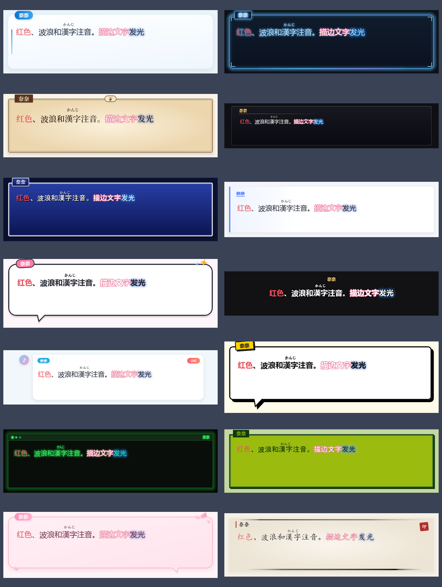

# 皮肤格式

皮肤是一个文件夹（或把它压缩成的 `.ntskin` 文件），根目录有一个 `skin.toml`，以及它引用的图片、字体和音效。设置 › 皮肤 › 导入皮肤 会先完整校验，通过后才安装；「复制为可编辑」会在数据目录里生成一个继承当前皮肤的副本并打开文件夹。

所有字段都有默认值（即未加修饰的「光环」的样子）。用 `base` 继承另一个皮肤时只需写不同的部分；表格逐层合并，其它值（包括 `[[dialogue.decor]]` 这样的数组）整体替换，写 `decor = []` 可清空继承来的装饰。

## 内置皮肤

| id | 名称 | 标签 | 特点 |
|---|---|---|---|
| `nanatype.halo` | 光环 | classic, minimal | 默认。柔光白卡片、左侧强调条、渐变胶囊名牌 |
| `nanatype.night` | 夜色 | classic | 深蓝玻璃、霓虹描边与流光下划线 |
| `nanatype.parchment` | 羊皮纸 | classic, elegant | 纸张渐变、双线框、花饰徽章、宋体 |
| `nanatype.adv` | ADV 经典 | game | 1280×240 全宽深色玻璃条、金色描边名字 |
| `nanatype.rpg` | RPG 窗口 | game, retro | 蓝色渐变窗口、白色双线框 |
| `nanatype.vanilla` | 香草 | streaming, minimal | 极简白条、左侧强调线、名字在框内 |
| `nanatype.bubble` | 气泡 | streaming, cute | 粗描边气泡、尾巴、倾斜名牌 |
| `nanatype.subtitle` | 字幕 | streaming, minimal | 无框，居中粗描边白字 |
| `nanatype.livechat` | 直播弹幕 | streaming | 评论栏风格：圆形头像、名字胶囊、白色气泡 |
| `nanatype.comic` | 漫画 | game, cute | 黑色粗线、硬投影、带影子的尾巴 |
| `nanatype.terminal` | 终端 | retro, minimal | 黑底绿字、标题栏、闪烁光标 |
| `nanatype.pixel` | 掌机像素 | game, retro | 四阶绿色、方角粗框、像素字 |
| `nanatype.sakura` | 樱花 | cute | 粉色渐变、花瓣点缀、爱心提示 |
| `nanatype.ink` | 水墨 | elegant | 宣纸、浓淡笔触、朱红印章、楷体 |
| `nanatype.echo_vanilla` | Echo-Live 原版 | streaming, minimal | 还原 Echo-Live 原版：白底、顶部灰线、右上角三角、名字左凸、底部菜单栏 |
| `nanatype.echo_glass` | Echo-Live 玻璃 | streaming | 还原 Echo-Live 玻璃：自下而上黑色渐变、黑边白字、菜单栏靠右 |
| `nanatype.echo_bubble` | Echo-Live 气泡 | streaming, cute | 还原 Echo-Live 气泡：白色圆角框、灰色粗边、右下硬投影 |
| `nanatype.echo_void` | Echo-Live 虚空 | streaming, minimal | 还原 Echo-Live 虚空：完全透明，只有黑字和灰色菜单栏 |



设置 › 皮肤 顶部的预览卡会用示例台词实时画出所选皮肤（含个性化设置），点每行的眼睛图标即可预览而不切换；标签和浅色 / 深色可用来筛选列表。内置皮肤都不带图片，想改造它们时用「复制为可编辑」。

## 清单

```toml
[meta]
id = "my.sakura"                  # a-z 0-9 . - _，最长 64
version = "1.0.0"
min_app = "0.1.0"                 # 需要的 NanaType 最低版本
base = "nanatype.halo"            # 可选：继承的皮肤
name = { zh-CN = "樱", en-US = "Sakura", ja-JP = "さくら" }
author = "你的名字"
license = "CC-BY-4.0"
preview = "preview.png"
tags = ["cute", "streaming"]      # 选择器里的分类：classic streaming game retro cute elegant minimal

[chrome]                          # 应用界面配色（设置、工具栏）
appearance = "light"              # light | dark
accent = "#e86a92"
background = "#fff5f8"
surface = "#ffffff"
text = "#3a2230"
muted = "#7a5a68"
border = "#f0cfdc"
# highlight = "#e86a92"           # 直播/注意态（镜像中、录制快捷键、排队）的粉色角色；
                                  # 省略时亮色界面为 #e86a92，暗色界面为 #ff8fb1

[chrome.dark]                     # 可选：用户把界面设为暗色而皮肤是亮色时使用
surface = "#2a1a24"               # 键与 [chrome] 相同（accent / background / surface / text /
                                  # muted / border / success / warning / danger / highlight），都可省略

[fonts.body]                      # 台词字体；name（名牌）、accent（装饰文字）同理
file = "fonts/LXGWWenKai.ttf"     # 随皮肤分发的字体（可选）
families = ["LXGW WenKai", "Microsoft YaHei UI", "PingFang SC"]   # 按顺序取第一个已安装的
weight = 500

[dialogue]
region = [760, 150]               # 对话区域（逻辑像素）
overscan = 18                     # 四周透明边距，防止跳动 / 描边被裁切
padding = [20, 22, 20, 14]        # 文字内边距：左 上 右 下
background = "images/bg.png"      # 可选
overflow = "scroll"               # 长文本：clip 裁掉 / scroll 跟随滚动（默认）/ page 满页后等待并清空
overflow_auto_ms = 1500           # page 模式下满页自动翻页的等待时间；省略则等继续键

[dialogue.box]
color = "#ffffffee"
border_color = "#f0cfdc"
border_width = 2
radius = 18
inner_border_color = "#ffe4ee"    # 可选的内框
inner_border_width = 2
glow = "#e86a9260"                # 可选的外发光
shadow = { color = "#00000030", dy = 3, blur = 8 }
frame = { image = "images/frame.png", slice = [24, 24, 24, 24], scale = 1 }   # 九宫格贴图，替代上面的绘制
width_fraction = 1.0              # 框宽占区域的比例
gradient = { angle = 160, stops = [[0, "#ffffff"], [1, "#ffe9f1"]] }   # 渐变，画在 color 之上
radii = [4, 18, 18, 18]           # 四个角分别的圆角：左上 右上 右下 左下（替代 radius）
border_widths = [0, 0, 0, 4]      # 四条边分别的宽度：上 右 下 左（替代 border_width）
border_style = "solid"            # solid | dashed | dotted
shadows = [                       # 更多阴影层；inset = true 为内阴影
    { color = "#e86a9240", dy = 6, blur = 18 },
    { color = "#ffffff", dy = 1, inset = true },
]
margin = [0, 0, 26, 0]            # 在区域内为尾巴、装饰留出的空间：上 右 下 左

[dialogue.tail]                   # 可选：对话气泡的尾巴，自动沿用框的填充和边框
side = "bottom"                   # top | right | bottom | left
at = 0.15                         # 尾巴根部在这条边上的位置（0–1）
width = 34                        # 根部宽度
length = 24                       # 伸出框外的长度
lean = -10                        # 尖端沿边偏移
shadow = true                     # 为尾巴复制框的硬阴影（blur = 0 的外阴影）
# color = "#ffe6ef"               # 填充，默认是框的颜色

[[dialogue.decor]]                # 装饰，可写多个（最多 16 个）
anchor = "top_right"              # 装饰自己的这个点对齐框的同名点，再加 offset
offset = [-18, -14]
size = [26, 26]                   # 像素，或框尺寸的百分比如 "56%"
# inset = [5, 5, 5, 5]            # 改为距四边的距离（可为负），用于内框线、底衬
text = "✦"                        # 可选：居中画一个字符（最多 8 个字）
text_color = "accent"
text_size = 22
font = "accent"                   # body | name | accent
rotate = 12                       # 顺时针角度
layer = "above"                   # above：画在框上；below：画在框下
when = "always"                   # always | speaker（仅在有名牌时显示）
                                  # | display（只在展示框与皮肤预览中画，输入窗不画；
                                  #   用于仿菜单栏这类看起来能点的装饰）
# 也可以有 color、gradient、radius、radii、border_color、border_width、
# border_widths、border_style、shadows、opacity，
# 以及 polygon = [[0, 0], [100, 0], [50, 100]]（按装饰尺寸的百分比裁成多边形，3–8 点）

[dialogue.text]
color = "#3a2230"
size = 28
line_height = 1.4
stroke = { color = "#ffffff", width = 2 }
shadow = { color = "#00000055", dx = 1, dy = 1, blur = 2 }
align = "start"                   # start | center | end

[dialogue.nameplate]
color = "#e86a92"
text_color = "#ffffff"
size = 18
radius = 10
padding = [10, 4]
anchor = "top_left"               # 名牌自己的这个点对齐框的同名点
offset = [16, -12]                # 再偏移；负值压在边框上
frame = { image = "images/nameplate.png", slice = [8, 8, 8, 8] }
stroke = { color = "#000000", width = 3 }   # 名字描边
text_shadow = { color = "#e86a92", blur = 8 }
gradient = { angle = 90, stops = [[0, "#ff8fb8"], [1, "#ffb3cf"]] }
radii = [10, 10, 10, 2]
border_color = "border"
border_width = 2                  # 或 border_widths = [0, 0, 2, 0] 只画下划线
shadows = [{ color = "#00000040", dx = 3, dy = 3 }]
rotate = -3

[dialogue.portrait]               # 立绘 / 头像
visible = true
side = "left"
size = [180, 220]
image = "images/portrait.png"
variants = { smile = "images/portrait-smile.png", angry = "images/portrait-angry.png" }

[dialogue.continue]               # 等待继续时的指示符
glyph = "▼"
color = "#e86a92"
size = 16
image = "images/continue.png"     # 可选：用图片代替字符
frames = 1                        # 图片是横向排列的多帧精灵图时填帧数
fps = 8
image_size = [22, 22]
anchor = "bottom_right"
offset = [-14, -8]
motion = "bob"                    # bob（浮动）| blink（闪烁）| pulse（缩放）| none
period_s = 0.83                   # 一个动作周期
bob_px = 3
# glyph = "" 且没有 image 时不显示

[dialogue.reveal]                 # 打字节奏
base_ms = 50                      # 每个拉丁字符
cjk_factor = 2.0                  # 中日韩字符等于几个拍子
punct = { comma_ms = 120, stop_ms = 260, ellipsis_ms = 300 }
entrance = { kind = "fade", ms = 140 }   # none | fade | pop | slide_up

[history]                         # 历史记录（blivechat 风格）
width = 420
height = 560
avatar = { shape = "circle", size = 40, ring_color = "#ffffff", ring_width = 2 }   # circle | square | none
# 头像还可写 color（主播无图头像的底色，默认强调色渐变）与 radius（square 的圆角，默认边长的 18%）；
# 观众的无图头像与名字胶囊按作者固定取 6 种颜色之一
name_color = "#e86a92"
name_size = 14
name_stroke = { color = "#000000", width = 2 }
name_plate = { color = "accent", text_color = "#ffffff", radius = 9, padding = [9, 2] }   # 名字胶囊（可选）
bubble_color = "#ffffffee"
bubble_border = "#f0cfdc"
bubble_border_width = 1
bubble_radius = 14
bubble_radii = [4, 14, 14, 14]
bubble_gradient = { angle = 135, stops = [[0, "#fff0f5"], [1, "#ffe1ec"]] }
bubble_shadows = [{ color = "#00000020", dy = 2, blur = 8 }]
bubble_frame = { image = "images/bubble.png", slice = [12, 12, 12, 12] }
gap = 10
entrance = "slide_up"             # none | slide_up | fade | slide_left
layout = "stack"                  # stack：名字和时间在气泡上方 | inline：名字、台词、时间同一行（聊天记录式）
                                  # stack 下同一人 2 分钟内的连续消息合并：只有第一条显示头像、名字和时间
name_width = 96                   # inline 时名字栏宽度
name_weight = 700
time_size = 11                    # 默认比名字小 3（也用于“主播/观众”角色标签）
time_seconds = false              # true 显示 HH:MM:SS
anchor = "bottom"                 # 行不足一屏时靠哪一端："bottom"（默认，新行贴底）或 "top"
hide_latest = false               # true：展示框上还显示着的那句先不进历史（设置 › 历史记录 可覆盖）
# 整个列表背后的面板（可选）；也支持 gradient / radii / border_widths / border_style / shadows
panel = { color = "#edeef0", border_color = "#888888", border_width = 0, radius = 0, padding = [18, 18, 18, 18], margin = [0, 0, 0, 0] }   # padding 左上右下，margin 上右下左
title = { text = "HISTORY", color = "#606266", size = 21, weight = 600, background = "#ffffff", height = 42, padding = 18 }   # 面板顶部标题栏（可选）

[[history.decor]]                 # 面板上的装饰，字段同 [[dialogue.decor]]（when 不适用）
anchor = "top_right"
size = [11, 11]
polygon = [[0, 0], [100, 0], [100, 100]]
color = "#00000026"

[history.text]
color = "#3a2230"
size = 18

[history.chat]                    # blivechat 弹幕行（设置 › 历史记录 › 弹幕 打开后出现）
text_scale = 0.88                 # 弹幕文字相对 history.text 的大小
bubble_opacity = 0.7              # 弹幕气泡相对 bubble_color 的不透明度

[history.reply]                   # 回复弹幕的台词，气泡上方的一行引用：头像 · 昵称：原文
visible = true
size = 12                         # 默认是正文的 62%
color = "#7a6070"                 # 原文颜色，默认同正文，可写颜色角色；昵称用 accent
opacity = 0.8

[dialogue.reply]                  # 对话框上的回复引用，字段同 [history.reply]
visible = true                    # 用户也可在 设置 › 联动 › blivechat 里关闭

[mention]                         # 台词里的 [at=…]：带头像和昵称的标签，输入框、对话框和历史记录一致
fill = "accent"                   # 标签底色，可写颜色角色
text_color = "#ffffff"
scale = 0.82                      # 相对周围文字的字号
avatar = true                     # 昵称前显示头像

[sounds]
typing = { files = ["sounds/key1.ogg", "sounds/key2.ogg"], volume = 0.6, pitch_jitter = 0.05, every_n = 1, min_interval_ms = 30 }
open = "sounds/open.ogg"          # 一句开始
advance = "sounds/advance.ogg"    # 按继续
se = { coin = "se/coin.ogg", boom = "se/boom.wav" }   # [se=coin]

[effects]                         # 逐字动效的默认幅度
shake_px = 1.6
wave_px = 3
jump_px = 6
rainbow_period_s = 2.4
screen_shake_px = 6
contrast_guard = 3.0              # 自带颜色的文字与框色对比低于 3:1 时加 1.5px 描边（0 = 关）
```

## 界面配色（chrome）

`[chrome]` 只决定设置窗口、输入框工具栏等应用控件的颜色，不影响展示框。NanaType 在把它交给界面之前会做几步处理，所以写得再鲜艳也不会糊满整个窗口：

- **混合中性色**：`background` 与 `surface` 按饱和度向 Nana 的中性底色（亮色 `#eaf4fb` / `#ffffff`，暗色 `#0f1724` / `#18233a`）混合，最高混入 65%。接近灰色的颜色保持不变；像 pixel 的荧光绿这类高饱和色只留下色调，品牌感交给 `accent`。
- **保证可读**：`text`、`muted` 在 `surface` 和 `background` 上至少 4.5:1，`success` / `warning` / `danger` 至少 3:1，不够时向文字色（或黑/白）推近；列表选中态与 `surface` 的亮度差（CIE L*）至少 6。
- **明暗不一致**：用户把界面设为暗色而皮肤是亮色（或反过来）时，不再退回 NanaUI 的灰色，而是用 Nana 色调的对立面板：暗色为 background `#0f1724`、surface `#18233a`、text `#e6eef8`、muted `#9fb3cc`、border `#2c3d58`，亮色为上面清单的默认值；皮肤的 `accent` 与 `highlight` 照常保留。需要自己指定时写 `[chrome.dark]` / `[chrome.light]`。
- **两种强调色**：`accent` 是主色（开关、滑块、每页唯一的主操作按钮——实心 accent，向右渐亮，1px 内高光与 accent 色投影）；`highlight` 是暖色的第二强调色，只用于直播 / 注意态。按钮文字按对比度自动选黑或白。
- **形状**：圆角档位为 4 / 8 / 12 / 16 / 20（色块与标签 / 控件 / 弹层 / 卡片 / 浮动条），胶囊为全圆角。亮色界面的设置卡片不描边，用 `0 8px 24px` 的文字色 16% 柔和阴影加 1px 白色顶部高光；暗色界面保留 1px 描边与 `0 10px 30px -12px #00000080` 阴影。

## 文字效果与对比度

- **发光**：文字的 `[shadow=颜色,0,0,模糊]`（无偏移即发光）画在亮色框上时，透明度最多 55%、模糊至少 10px，看起来是光而不是一团脏影。工具栏插入的发光默认使用皮肤的 `accent`。
- **对比保护**（`effects.contrast_guard`）：自带颜色的一段文字与 `dialogue.box.color`（历史记录里为 `history.bubble_color`）对比低于该值时，在其下方加 1.5px 描边，颜色取皮肤文字、框线中离这段文字最远的那个墨色（pixel 为 `#0f380f`）。已有描边的文字不变；框色透明度低于 50% 时不判断。内置的亮色皮肤、pixel 与 terminal 默认为 3.0，其余为 0（关闭）。
- **皮肤的文字阴影**：`dialogue.text.shadow` 是有色发光（如 terminal 的绿色、night 的蓝色）时，自带颜色的文字改用自己的颜色发光，不会再套上皮肤的绿光；黑色等中性投影保持不变。
- 以上只作用于展示框、历史记录与皮肤预览；输入框里的文字始终按原样显示，以便原样保存。

## 颜色、渐变与阴影

颜色写作 `#rgb`、`#rgba`、`#rrggbb` 或 `#rrggbbaa`。上面新增的字段（渐变色标、`shadows`、尾巴、装饰、名牌边框、历史名字胶囊、头像圆环）还可以写颜色角色，跟随皮肤里的对应颜色，也会跟随用户的个性化设置：

| 角色 | 对应 |
|---|---|
| `box` | `dialogue.box.color` |
| `border` | `dialogue.box.border_color` |
| `accent` | `chrome.accent` |
| `text` | `dialogue.text.color` |
| `name` | `dialogue.nameplate.color` |
| `name_text` | `dialogue.nameplate.text_color` |

渐变 `gradient = { kind, angle, center, circle, stops }`：`kind` 为 `linear`（默认，`angle` 与 CSS 相同，0 = 向上，90 = 向右，默认 180）或 `radial`（`center` 为百分比，默认 `[50, 50]`）；`stops` 为 2–8 个 `[位置 0–1, 颜色]`，位置不能递减。渐变不能画在边框上，需要渐变边框时可用一个 `layer = "below"`、`inset` 为负值的装饰垫在框下。

每个框最多 4 层阴影，旧字段 `inner_border_color`、`glow`、`shadow` 也各占一层。

在设置里覆盖「展示框颜色」会关闭框的渐变，覆盖「名牌颜色」会关闭名牌的渐变，以便所选颜色可见。

## 字体

NanaUI 一次只用一个字体名，NanaType 会从 `families` 里挑第一个已安装的放在最前；都没装时使用系统默认字体。皮肤里随附的 `file` 字体总是优先。

## 兼容性

使用上面新增字段的皮肤在旧版 NanaType 中仍能加载，只是新字段会被忽略并提示。如果皮肤离不开它们，请把 `min_app` 设为支持它们的版本。`effects.rainbow_saturation` 和 `rainbow_lightness` 目前保留，暂不生效。

## 校验规则

导入时以下任何一项不满足都会拒绝整个皮肤，并显示具体字段：

- `schema` 比当前程序新，或 `min_app` 高于当前版本；
- `id` 不合法，或与内置皮肤重名；
- 路径越界（`..`、绝对路径、盘符）或文件缺失；
- 单个文件超过 64 MiB，或整个皮肤超过 256 MiB；
- 图片不是 PNG / JPEG / WebP / GIF，边长超过 8192，或九宫格切片超出图片；
- 字体无法解析；音效不是 WAV / OGG / FLAC / MP3；
- 颜色或数值不合法（如字号不在 4–400）；
- 渐变色标不是 2–8 个或位置递减；圆角不在 0–2000、边框不在 0–64；阴影超过 4 层；
- 装饰超过 16 个、多边形不是 3–8 点、文字超过 8 个字；尾巴、`continue` 的帧数和速度超出范围；`margin` 占满了区域。

`tags` 不合规只会提示。

清单中不认识的字段只会提示，不影响加载，以便旧版本打开新皮肤。

## 热重载

制作皮肤时，在 设置 › 皮肤 打开「文件变化时自动重载」，修改文件夹中的文件后展示框会立即更新。
